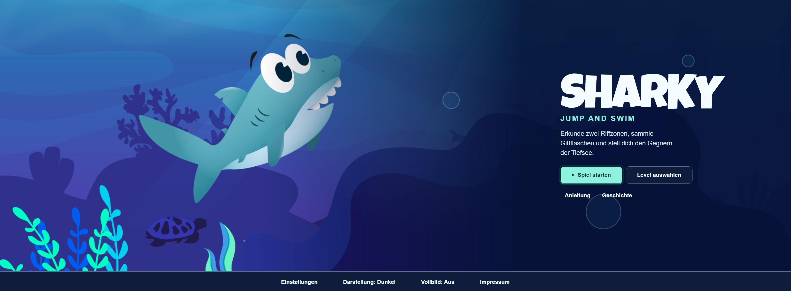
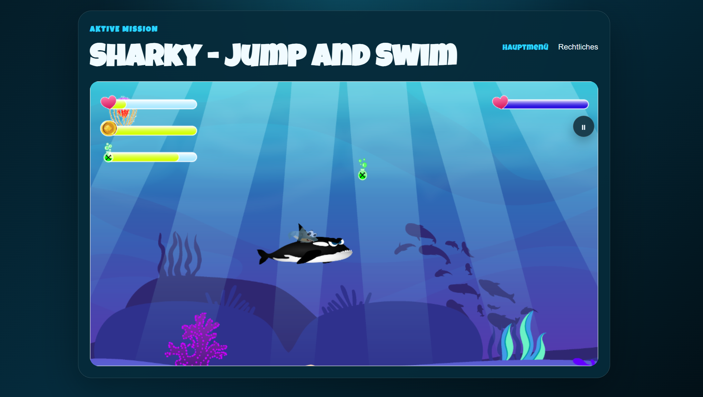
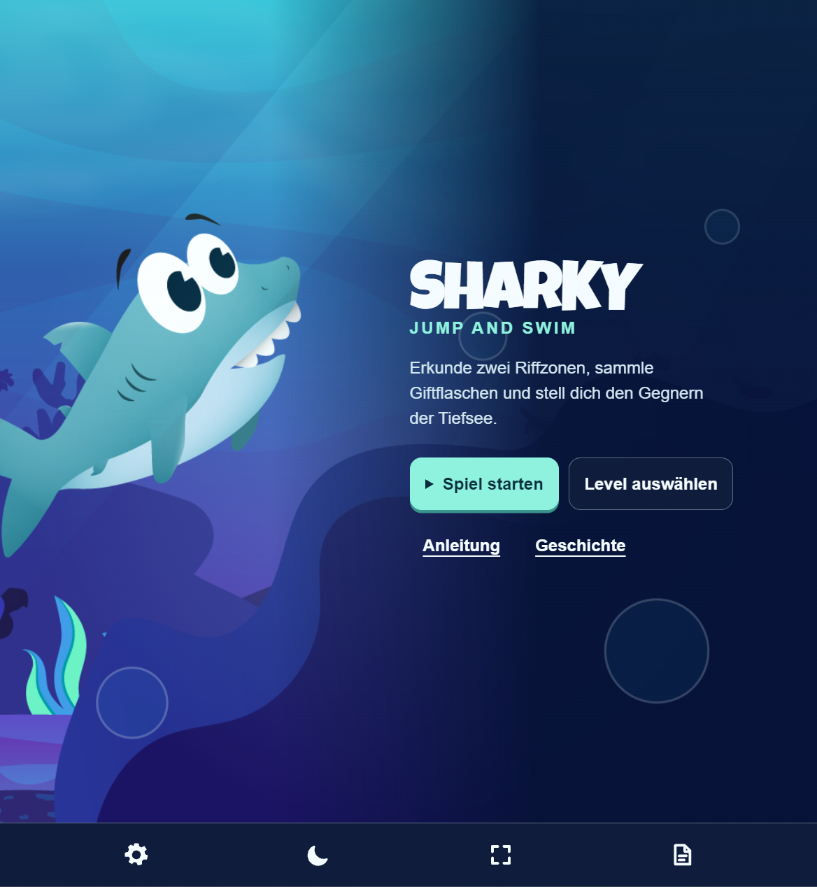

<div align="center">


# Sharky – Jump and Swim

Zwei Riffe, drei Angriffe und ein Orca am Ende jeder Strecke. Ein responsives 2D-Unterwasserspiel für Tastatur und Touch.

[](#tech-stack)
[](#tech-stack)
[](#tech-stack)
[](#qualitätssicherung)

[Quickstart](#quickstart) · [Steuerung](#steuerung) · [Technische Dokumentation](docs/README.md)

</div>

## Inhaltsverzeichnis

1. [Über das Spiel](#über-das-spiel)
2. [Voraussetzungen](#voraussetzungen)
3. [Quickstart](#quickstart)
4. [Steuerung](#steuerung)
5. [Tech Stack](#tech-stack)
6. [Architektur](#architektur)
7. [Qualitätssicherung](#qualitätssicherung)
8. [Dokumentation und Projektmaterial](#dokumentation-und-projektmaterial)

## Über das Spiel

Ich habe Sharky als Frontend-Einzelprojekt in der Weiterbildung bei der Developer Akademie umgesetzt. Sharky kann in vier Richtungen schwimmen, Felsen umqueren und Gegner mit der Flosse oder mit Blasen angreifen. Münzen werden zwischen den Riffen gegen Upgrades getauscht. Giftflaschen sind Munition für den Bosskampf.



Im ersten Riff werden Steuerung und Angriffe eingeführt. Nach dem Bosskampf wird am Ausgang der Shop geöffnet. Im zweiten Riff sind mehr Gegner gleichzeitig unterwegs und der Orca greift in kürzeren Abständen an. Über die Levelauswahl kann jedes Riff auch einzeln gestartet werden.



## Voraussetzungen

| Zweck | Voraussetzung |
| --- | --- |
| Spielen | Aktueller Browser mit JavaScript und Canvas 2D. Auf Handy und Tablet ist das Spiel fürs Querformat ausgelegt. |
| Lokal starten | Statischer HTTP-Server im Projektverzeichnis. Für die Befehle unten werden Git und Python 3 verwendet. Bei einem entpackten ZIP entfällt das Klonen. |
| Optionale Projektprüfungen | Node.js und npm. In der [Paketdefinition](package.json) ist Node.js ab Version 18 angegeben. |

Die Spielressourcen werden direkt über HTTP geladen. Für die Anwendung sind weder ein Build noch eine Paketinstallation erforderlich.

## Quickstart

```sh
git clone https://github.com/CZX93-BW/SharkyProject.git
cd SharkyProject
```

**Windows (CMD oder PowerShell)**

```cmd
py -m http.server 8000 --bind 127.0.0.1
```

**Linux oder macOS**

```sh
python3 -m http.server 8000 --bind 127.0.0.1
```

Unter [localhost:8000](http://127.0.0.1:8000/) wird das Hauptmenü angezeigt. **Spiel starten** öffnet Level 1. Mit **Strg+C** wird der Server beendet. Alternativ kann die [index.html](index.html) mit Live Server in VS Code geöffnet werden.

## Steuerung

| Aktion | Tastatur | Touch im Querformat |
| --- | --- | --- |
| Schwimmen | Pfeiltasten oder W, A, S, D | Joystick links |
| Flossenschlag | E | Flosse |
| Blasenfalle | Leertaste | Blase |
| Giftangriff | F | Gift |
| Pause / Fortsetzen | Esc oder Pausenschaltfläche | Pause / Fortsetzen |

Der Flossenschlag trifft kurz vor Sharky in Blickrichtung. Kleine Gegner können mit der Blasenfalle vorübergehend unschädlich gemacht werden. Der Giftangriff verbraucht eine Flasche und wirkt auch gegen den Boss. [Trefferbereich des Flossenschlags](docs/features/player-combat.md#trefferbereich-des-flossenschlags)

<details>
<summary>Hauptmenü bei schmaler Fensterbreite</summary>



</details>

## Tech Stack

| Bestandteil | Einsatz |
| --- | --- |
| Vanilla JavaScript | Klassische Skripte und Klassen für Spielfigur, Gegner, Level, Spielzustand und Fachsysteme |
| HTML und Canvas 2D | Semantisches HTML für Menüs und Dialoge, Canvas für Spielwelt, Animationen und Statusleisten |
| CSS | Getrennte Stylesheets für Oberfläche, Spielfläche, Querformat, Farbschema und Rechtliches |
| Browser-APIs | Bildausgabe per `requestAnimationFrame`, Pointer Events für Touch, Audioelemente für Musik und Effekte, `localStorage` für Einstellungen |
| Node.js | Optionale statische Projektvalidierung und Regressionstests mit `node:test` |

## Architektur

Die Anwendung wird in [main.js](js/main.js) zusammengesetzt. Beim Start eines Riffs übernimmt `Game` die Spielschleife. Eingaben werden eingelesen, die Welt wird in festen Zeitschritten aktualisiert und anschließend gezeichnet. Die HTML-Oberfläche erhält den Spielzustand über einen Callback.

| Bereich | Zuständigkeit und technische Beschreibung |
| --- | --- |
| `config`, `levels` | Spielwerte, Assetpfade und Aufbau der konkreten Riffe. [Levelaufbau und Gegnererzeugung](docs/features/enemies-levels.md) |
| `core`, `entities`, `systems` | Gemeinsame Objektgrundlagen, konkretes Verhalten und objektübergreifende Regeln. [Klassen und Abhängigkeiten](docs/architecture/application.md) |
| `game` | Spieltakt, Sitzungszustand, Kamera und Rendering. [Spielschleife](docs/architecture/game-loop-state.md) · [Darstellung](docs/architecture/rendering-assets.md) |
| `input`, `ui` | Gemeinsame Eingaben für Tastatur und Touch, Dialoge und Statuswechsel. [Steuerung und Menüs](docs/features/interface-controls.md) |

## Qualitätssicherung

Für die Spielprüfung sind Treffergefühl, Bedienbarkeit und die Übergänge bei Niederlage, Shop und Sieg entscheidend. Ergänzend können mit `npm run check` die Projektvalidierung und die vorhandenen Node-Tests ausgeführt werden. [Prüfwege und Ergebnisse](docs/engineering/testing-validation.md)

## Dokumentation und Projektmaterial

Die [Dokumentationsübersicht](docs/README.md) verbindet Architektur, Spielmechanik, Oberfläche und Betrieb. Die Sharkie-Grafiken stammen aus dem bereitgestellten Kursmaterial. Die eingebundene Schrift Luckiest Guy wird mit ihrer [Lizenz](assets/licenses/luckiest-guy-license.txt) ausgeliefert.

[Bastian Wollny auf GitHub](https://github.com/CZX93-BW) · [Rechtliches](legal.html)
