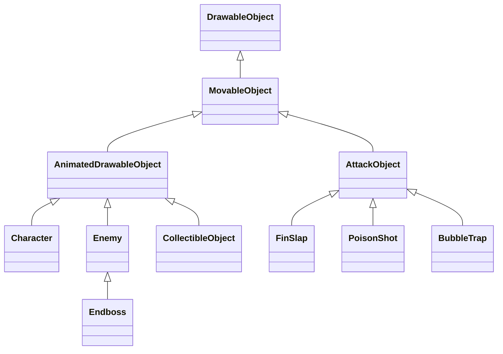

# Anwendungsaufbau

Ich habe die Spielwelt und ihre Bedienoberfläche getrennt. Im Canvas werden bewegliche Objekte in Weltkoordinaten gezeichnet. Für Startmenü, Einstellungen, Shop und Endbildschirme werden HTML-Elemente verwendet. Der aktuelle Spielzustand verbindet beide Bereiche.

## Einstieg und Abhängigkeiten

Die Skripte werden als klassische Browser-Skripte über [index.html](../../index.html) eingebunden. Die Reihenfolge ist Teil der Anwendung. Vor einer abgeleiteten Klasse muss ihre Basisklasse bekannt sein. Beim Erzeugen der Level müssen außerdem die Konfiguration und die verwendeten Objektklassen bereits geladen sein.

Im `load`-Handler von [main.js](../../js/main.js) werden Tastatur, Audio, Bildschirmverwaltung und Anzeigeeinstellungen initialisiert. Die Touchsteuerung erhält dieselbe Tastaturinstanz wie das Spiel. An `Game` werden Canvas, Eingabe, Audio und ein Callback für Statusänderungen übergeben. Der `UiController` erhält anschließend die Spielinstanz und registriert die Bedienaktionen.

## Verzeichnisstruktur

| Pfad | Was hier festgelegt wird |
| --- | --- |
| [js/config](../../js/config) | Globale Spielwerte, Levelprofile sowie Pfade und Reihenfolgen der Assets |
| [js/core](../../js/core) | Grundklassen für Position, Bildausgabe, Bewegung und Animation sowie Uhr und Zufallsquelle |
| [js/entities](../../js/entities) | Konkrete Spielobjekte, gegliedert nach Spieler, Gegnern, Angriffen und Weltobjekten |
| [js/levels](../../js/levels) | Platzierung von Felsen, Münzen, Flaschen, Boss und Ausgang in jedem Riff |
| [js/game](../../js/game) | Spielschleife, Zustand, Levelcontainer, Kamera und Renderer |
| [js/systems](../../js/systems) | Regeln, an denen mehrere Objekte beteiligt sind, darunter Kollisionen, Spawns und Audio |
| [js/input](../../js/input) und [js/ui](../../js/ui) | Tasten- und Pointerzustände sowie Wechsel zwischen den HTML-Ansichten |
| [styles](../../styles) und [assets](../../assets) | Gestaltung und lokale Spielressourcen |

## Klassenmodell

Gemeinsames Zeichen- und Bewegungsverhalten wird schrittweise vererbt. Ob eine Giftflasche eingesammelt oder ein Gegner vergiftet werden kann, wird erst in den jeweiligen Fachklassen entschieden.

In [DrawableObject](../../js/core/drawable-object.class.js) werden Position, Abmessungen und Bildzugriff zusammengefasst. Über [AnimatedDrawableObject](../../js/core/animated-drawable-object.class.js) stehen benannte Bildfolgen und deren Abspielzustand zur Verfügung. Ein Hintergrund oder eine Statusleiste kann direkt von der Zeichenbasis abgeleitet werden.

## Zusammensetzung und Objektbesitz

- In [GameState](../../js/game/game-state.class.js) werden Spieler, aktives Level, Spielstatus, Münzen, Gift und gekaufte Upgrades gehalten. Hier wird entschieden, welche Werte einen Levelwechsel überdauern.
- Im [Level](../../js/game/level.class.js) werden Hindernisse, feste Kollisionsflächen, Sammelobjekte, Gegnerliste, Spawner, Boss und Ausgang zusammengeführt. Für Angriffe und Berührungsschaden werden unterschiedliche Objektlisten bereitgestellt.
- In [Game](../../js/game/game.class.js) werden Eingabe, Kamera, Angriffssystem, Kollisionserkennung und Renderer koordiniert. Die Bossbewegung und die Suche nach Spawnplätzen haben eigene Klassen. Dadurch lassen sich Bewegungsregeln und Platzierungsregeln getrennt lesen.
- Über den Status-Callback wird der Zustand an die Oberfläche übergeben. Im [UiStatusController](../../js/ui/ui-status-controller.class.js) werden daraus Texte, Shopbuttons und Statusbildschirme abgeleitet. Der Canvas-Renderer liest denselben Spielzustand für die grafischen Anzeigen.

## Beispiel für den Datenfluss

Beim Drücken von F wird in der Eingabe ein Giftangriff vorgemerkt. Im nächsten Simulationsschritt werden Flankenzustand, Abklingzeit und Vorrat geprüft. Bei erfolgreichem Schuss wird eine Flasche verbraucht und ein Projektil angelegt. Nach der Bewegung werden Kontakte geprüft. Der Renderer erhält anschließend die verbleibenden Projektile und den geänderten Inventarstand.

[Simulationsschritt](game-loop-state.md) · [Kampf und Kollisionen](../features/player-combat.md) · [Bildausgabe](rendering-assets.md)

[Dokumentationsübersicht](../README.md) · [Projekt-README](../../README.md)
